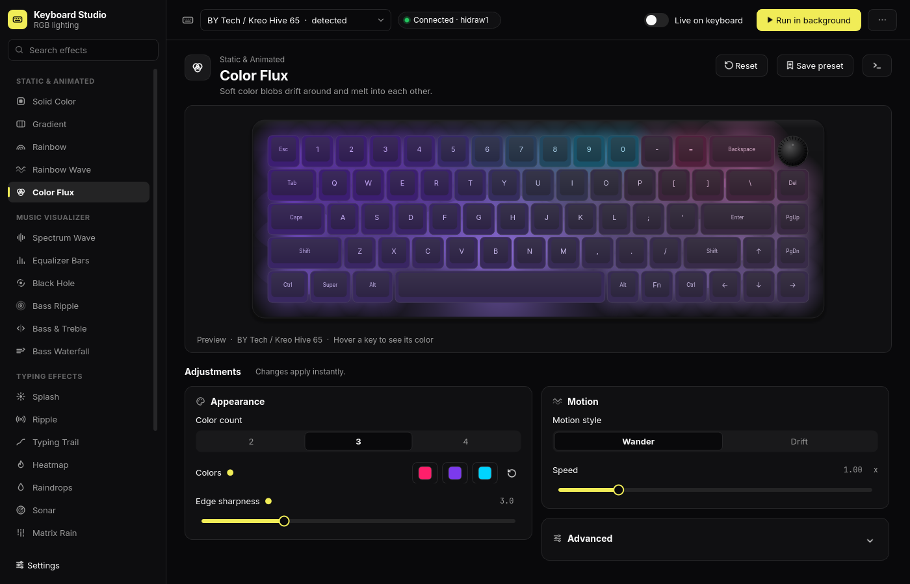

# Kreo Hive 65 - RGB Control for Linux (with an audio visualizer!)

Control your Kreo Hive 65 keyboard's RGB from Linux, no Windows software
needed. Set any color per key, paint gradients, and run an audio-reactive
mode that turns the whole board into a live soundwave for whatever your PC
happens to be playing. And when the sound stops, it quietly drifts into an
ambient gradient on its own.

It works with the wired 65% keyboard that shows up on USB as `258a:010c`
"BY Tech Gaming Keyboard" (that's the Kreo Hive 65). The Aula F75 uses the
same chip and works too, with one extra flag. See
[Using it with an Aula F75](#using-it-with-an-aula-f75).

Rather click than type? **Keyboard Studio** is a desktop app that previews
every effect on an on-screen copy of your keyboard, lets you tune it with
sliders, and leaves it running in the background. See
[Desktop app (Keyboard Studio)](#desktop-app-keyboard-studio).



## What you need

- Any modern Linux (Arch, Ubuntu, Fedora, Mint, take your pick) with
  PipeWire or PulseAudio. Every mainstream distro from the last few years
  ships one of them.
- Python 3, which is already there on most distros. The command-line tool
  needs no pip packages. The optional desktop app is a single download (an
  AppImage), or one `pip` command if you run it from the source.
- The keyboard plugged in with its USB cable, in wired mode. Bluetooth and
  the 2.4 GHz dongle won't cut it, since the RGB channel only exists over
  the cable.

## Setup (one time, about 2 minutes)

**1. Grab the files.** Drop `keyboardrgb.py` and `60-keyboardrgb.rules` into
a folder, say `~/kbd-re`, and open a terminal there.

**2. Give yourself permission to talk to the keyboard.** Out of the box
Linux only lets root touch the keyboard's control channel. This installs a
rule that basically says "whoever is sitting at this computer may control
this specific keyboard". It's scoped to this one device and trivial to undo
later (just delete the file):

```bash
sudo cp 60-keyboardrgb.rules /etc/udev/rules.d/
sudo udevadm control --reload
```

Now unplug the keyboard's USB cable and plug it back in so the rule takes
effect.

> The `60-` at the front of the filename actually matters. udev applies the
> access tag in a step numbered 73, so the rule has to sort before it. Don't
> rename it to something like `99-whatever`, or it'll silently do nothing.

**3. Try it out:**

```bash
python3 keyboardrgb.py color ff0000     # whole board red (Ctrl-C to stop)
python3 keyboardrgb.py rainbow          # rainbow across the keys
python3 keyboardrgb.py off              # everything off
```

If the board turned red, you're done. If you got `Permission denied`, jump
to Troubleshooting below.

> Heads up: `color`, `rainbow`, `gradient`, `key`, and `wave` keep running
> and hold their colors until you press Ctrl-C. That's deliberate. The
> keyboard snaps back to its own built-in lighting the moment the program
> stops, so the tool has to stay alive to hold your colors in place. If
> you'd rather set a color and have the command exit right away (from a
> startup script, say), add `--once`:
> `python3 keyboardrgb.py color ff0000 --once`.

## Using it with an Aula F75

The Aula F75 runs the same firmware as the Hive 65. It even reports the exact
same USB id (`258a:010c`), so the setup above works as-is: the udev rule
already covers it, and there's nothing else to install. The difference is the
layout. The F75 is a 75% board with an extra F-key row and a knob, and its
LEDs are numbered differently.

Because both boards look identical over USB, the tool can't tell them apart
and assumes a Hive 65. On an F75 that shows up as colors landing on the wrong
keys (the F-row especially). The fix is to tell it which board you have by
adding `--profile aulaf75` to every command:

```bash
python3 keyboardrgb.py --profile aulaf75 color ff0000
python3 keyboardrgb.py --profile aulaf75 rainbow
python3 keyboardrgb.py --profile aulaf75 audio --effect vortex
python3 keyboardrgb.py --profile aulaf75 key f1 ff0000 f2 00ff00 knob 0000ff
```

The flag can go anywhere on the line, before or after the command. Check that
it took by looking at the first line of output, which should say
`device: /dev/hidrawN (Aula F75 (258a:010c))`.

To avoid typing it every time, add an alias to your shell config:

```bash
alias kbd='python3 ~/kbd-re/keyboardrgb.py --profile aulaf75'   # bash/zsh
# then: kbd audio --effect bars
```

(fish: `alias kbd 'python3 ~/kbd-re/keyboardrgb.py --profile aulaf75'; funcsave kbd`)

**Extra key names** on the F75, in addition to the list under
[Other commands](#other-commands): `grave` (the `` ` `` key), `f1` to `f12`,
`end`, and `knob`. It has no `home` or `ralt` key.

**Not yet confirmed on hardware:** the knob's LED, and whether `f11`/`f12` sit
where the profile puts them. If one of those lights the wrong key, run the
slot walker, which lights one LED at a time and prints its number:

```bash
python3 keyboardrgb.py --profile aulaf75 walk --start 60 --end 100
```

Note which slot lights which key, then fix that key's entry in
`profiles/zaula-f75.json` (add `"slot": N` to it to override the formula).
The file's `note` field explains the numbering.

**Web UI:** the WebSocket bridge (`kbd_ws_server.py`, used by the browser app
in `client/`) always uses the Hive 65 layout for now. On an F75 it still
drives the main block, but the F-row and knob won't map correctly.

## Audio-reactive mode


https://github.com/user-attachments/assets/8e475d93-be6e-4a3d-a416-4831388860dd

The order of effect is wave -> bars -> wave

```bash
python3 keyboardrgb.py audio
```

That's the whole thing. Play some music and the keyboard becomes a
16-column spectrum wave: bass on the left, treble on the right, rippling out
from the middle row. It grabs whatever your system is outputting (Spotify,
YouTube, games, anything at all), no matter whether it's headed to speakers
or headphones. Press Ctrl-C to stop.

### Effects (`--effect`)

Pick the visual style you want. They all react to your audio in real time:

| Effect             | Looks like                                                                                 | Reacts to                                                                                                                                                                 |
| ------------------ | ------------------------------------------------------------------------------------------ | ------------------------------------------------------------------------------------------------------------------------------------------------------------------------- |
| `wave` _(default)_ | a spectrum that swells out from the home row                                               | each column is one frequency band                                                                                                                                         |
| `bars`             | a classic equalizer — grows bottom-up by default; `--direction` picks the edge it grows from | column (or row) height tracks band loudness                                                                                                                             |
| `split`            | bass glowing in from the left edge and treble from the right, fading to dark in the middle  | the left half brightens with bass, the right half with treble, so beats push in from the sides                                                                            |
| `flow`             | a bass "waterfall" — the left column tracks the bass and each punch then travels across to the right     | only the leftmost column samples the bass; that reading scrolls rightward every frame, so a beat enters at the left and glides to the right edge (speed set by `--flow-speed`) |
| `vortex`           | a black hole, with a dark void in the middle and a color accretion ring swirling around it | the colors spin faster the louder it gets, each frequency lights its own slice of the ring, and bass swells the hole and shoves the ring outward so beats give it a pulse |
| `ripple`           | concentric rings breathing out from the middle                                             | bass hits push the rings outward, and overall loudness sets the brightness                                                                                                |

```bash
python3 keyboardrgb.py audio --effect vortex
python3 keyboardrgb.py audio --effect ripple
python3 keyboardrgb.py audio --effect bars
python3 keyboardrgb.py audio --effect split
python3 keyboardrgb.py audio --effect flow
```

#### Bar direction (`--direction`)

`bars` grows bottom-up by default. `--direction` (only meaningful for `bars`)
changes which edge the bars grow from. `bottom`/`top` are vertical (one band per
column); `left`/`right`/`sides` are horizontal (one band per row).

| `--direction`      | The equalizer bars…                                    |
| ------------------ | ------------------------------------------------------ |
| `bottom` _(def.)_  | grow up from the bottom row                            |
| `top`              | hang down from the top row                             |
| `left`             | grow rightward from the left edge                      |
| `right`            | grow leftward from the right edge                      |
| `sides`            | grow inward from both edges and meet in the middle     |

```bash
python3 keyboardrgb.py audio --effect bars --direction top
python3 keyboardrgb.py audio --effect bars --direction sides
python3 keyboardrgb.py audio --effect bars --direction left --gain 1.5
```

### Make it yours

These knobs work with every effect:

| Option                         | What it does                                                                                                                                 | Default |
| ------------------------------ | -------------------------------------------------------------------------------------------------------------------------------------------- | ------- |
| `--mode colorful`              | a 4-color gradient (red, violet, cyan, amber) scrolling across the board                                                                     | default |
| `--mode single --color ff2000` | just one color of your choosing                                                                                                              |         |
| `--gain 1.5`                   | amplitude multiplier. Bigger number, wilder reaction. Try somewhere in `0.5` to `3`                                                          | `1.0`   |
| `--smooth 2`                   | smoothness multiplier. Bigger is silkier and slower, smaller is twitchy and snappy. Try `0.5` to `3`                                         | `1.0`   |
| `--scroll 0.3`                 | how fast the gradient drifts across the keys, in cycles per second. `0` freezes it in place (`vortex` ignores this one, it spins on its own) | `0.15`  |
| `--radius 0.45`                | `vortex` only: size of the dark hole in the middle, from `0` to `1`. Bigger means a wider void and the ring pushed further out               | `0.18`  |
| `--flow-speed 5`               | `flow` only: how fast a bass punch travels left-to-right, in columns per second. Lower is a slower, more visible sweep                        | `8.0`   |
| `--fps 60`                     | frames per second. The default 30 looks smooth and stays light on the CPU; push it up toward 60 (the board's ceiling) for silkier motion     | `30`    |

> About the default palette: it's `#FF4242`, `#7C3AED`, `#06B6D4` and
> `#EAB308`, a soft red, violet, cyan and amber. They're deliberately more
> pastel than the harsh, full-saturation RGB the keyboard blasts on its own.
> Easier on the eyes, and honestly just nicer to look at. Miss the loud
> stuff? `--mode single --color <hex>` or the standalone `rainbow` command
> still hand you full-saturation colors.

A few examples:

```bash
python3 keyboardrgb.py audio --effect vortex --radius 0.4         # black hole, wider void
python3 keyboardrgb.py audio --effect ripple --mode single --color 00ffcc
python3 keyboardrgb.py audio --mode single --color 00ffcc --smooth 2
python3 keyboardrgb.py audio --effect bars --gain 1.5 --smooth 0.6
```

Volume doesn't matter, by the way. The visualizer auto-levels to the music's
own dynamics, and `--gain` scales on top of that.

> `--shape` was the old name for `--effect` and it still works, so any older
> commands you've got lying around keep running fine.

### When the music stops (`--default`)

You can leave the visualizer running all day and it won't just sit on a dead
black board during the quiet stretches. After 3 seconds of silence it
smoothly crossfades into an ambient, non-audio effect, and the instant sound
comes back it fades right back to reacting. Both transitions are gentle, no
jarring cuts.

| Option                 | What it does                                                                                                                                                                   | Default    |
| ---------------------- | ------------------------------------------------------------------------------------------------------------------------------------------------------------------------------ | ---------- |
| `--default gradient`   | the idle effect: `gradient` (the scrolling 4-color gradient), `breathe` (the whole board drifting through the palette), `wave` (a rolling brightness wave), or `off` (go dark) | `gradient` |
| `--idle-gap 3`         | seconds of silence before it switches over                                                                                                                                     | `3`        |
| `--silence-level 0.01` | how quiet counts as "silence". Raise it if a noisy line keeps it awake, lower it if quiet passages trip it                                                                     | `0.004`    |

```bash
python3 keyboardrgb.py audio --default breathe            # breathe softly when idle
python3 keyboardrgb.py audio --default off --idle-gap 2   # just go dark after 2s of quiet
```

### Other commands

```bash
python3 keyboardrgb.py key w ff0000 a ff0000 s ff0000 d ff0000   # light up WASD
python3 keyboardrgb.py gradient ff00ff 00ffff                    # left to right gradient
python3 keyboardrgb.py wave                                      # rainbow animation, forever
python3 keyboardrgb.py wave 30                                   # ...or just 30 seconds
```

All of these hold until Ctrl-C (add `--once` to set one frame and exit).
`wave` runs forever unless you hand it a number of seconds.

Key names: letters and digits as printed, plus `esc tab capslock lshift
rshift lctrl rctrl lwin lalt ralt fn space enter backspace del home pgup
pgdn up down left right minus equal lbracket rbracket backslash semicolon
quote comma period slash`.

## Screen sync

Turn the keyboard into an ambient extension of your screen. It grabs your
monitor, shrinks it to a blurry 144p, and paints that onto the keys — so the
lighting glows with whatever colors are on screen (a bright game, a video, your
wallpaper). It's a soft, low-res reflection, not a tiny display.

```bash
python3 keyboardrgb.py screen
```

By default it follows whichever monitor has focus and switches live as you move
between them (on Hyprland). It's deliberately light: your display is captured
with `grim`, and a single `ffmpeg` does the 144p downscale, blur, and squeeze
down to the key grid, so Python barely does any work (a few hundred bytes per
frame).

You'll need `ffmpeg`, plus `grim` on Wayland (both are one package away on every
distro). On X11 it uses `ffmpeg`'s `x11grab` instead and no `grim` is needed.

Knobs:

| Flag           | Does                                                                 |
| -------------- | ------------------------------------------------------------------- |
| `--output NAME`| pin one monitor instead of following focus (`hyprctl monitors` / `wlr-randr` lists names) |
| `--no-follow`  | stop chasing focus; stay on the current (or `--output`) monitor      |
| `--saturation` | punch the colors up (default `1.5`); `1` = as-is                     |
| `--gain`       | overall brightness (default `1.1`)                                   |
| `--blur`       | blur radius in px at 144p (default `2`, `0` = crisp-ish)             |
| `--smooth`     | temporal smoothing `0..0.95` (default `0.5`; higher = calmer)        |
| `--raw`        | faithful colors — no saturation/gain/gamma, a literal mirror         |
| `--fps N`      | frame rate (default `24`; drop it to shave CPU further)              |

```bash
python3 keyboardrgb.py screen --output HDMI-A-1        # pin the external monitor
python3 keyboardrgb.py screen --raw --smooth 0.7       # true colors, extra calm
python3 keyboardrgb.py screen --saturation 2 --gain 1.3 # vivid and bright
```

## Fun commands to try

Copy-paste any of these. Press Ctrl-C to stop.

### Audio-reactive (put some music on first)

```bash
# the black hole, wide dark void, extra punchy
python3 keyboardrgb.py audio --effect vortex --radius 0.4 --gain 1.5

# neon black hole, hot-pink ring, single color instead of the gradient
python3 keyboardrgb.py audio --effect vortex --mode single --color ff0055

# bass ripples breathing out from the center
python3 keyboardrgb.py audio --effect ripple --gain 1.4 --smooth 1.5

# aggressive twitchy equalizer, snaps hard on every beat
python3 keyboardrgb.py audio --effect bars --smooth 0.5 --gain 2

# dreamy chill wave, slow, silky, barely-drifting colors
python3 keyboardrgb.py audio --effect wave --smooth 2.5 --scroll 0.05

# rave mode, fast gradient ripping across the keys
python3 keyboardrgb.py audio --scroll 0.6 --gain 1.5

# cyberpunk cyan rings
python3 keyboardrgb.py audio --effect ripple --mode single --color 00ffcc

# leave it on all day: reacts to music, breathes the gradient when it's quiet
python3 keyboardrgb.py audio --default breathe

# party then chill: punchy bars that melt into a slow gradient after 3s of quiet
python3 keyboardrgb.py audio --effect bars --gain 1.8 --default gradient --idle-gap 3
```

### Ambient (no music needed)

```bash
python3 keyboardrgb.py wave                     # endless flowing rainbow
python3 keyboardrgb.py gradient ff6a00 8a2be2   # sunset: orange to purple
python3 keyboardrgb.py gradient 001b8a 00ffd5   # deep ocean: navy to aqua
python3 keyboardrgb.py color 00ffaa             # solid neon mint
python3 keyboardrgb.py key w ff2200 a ff2200 s ff2200 d ff2200   # gamer WASD
```

### The three knobs worth playing with

- `--gain` is intensity. `0.5` is subtle, `2` and up gets wild.
- `--smooth` is personality. Low (`0.4`) is twitchy and snappy; high (`2.5`)
  is liquid and dreamy.
- `--scroll` is how fast the gradient drifts. `0` freezes it, `0.6` is a
  full-on rave.

Mix them however you like with any `--effect` (`wave`, `bars`, `split`, `flow`,
`vortex`, `ripple`) and `--mode single --color <hex>`. Start with the vortex;
on a bass-heavy track it looks the best.

## Desktop app (Keyboard Studio)

If you'd rather click than type, Keyboard Studio shows every effect on a
realistic on-screen copy of your keyboard. Pick an effect on the left, watch it
run in the middle, and tune it with the controls underneath. Hover over any
button, slider or key and a tooltip tells you what it does.

### Download it (AppImage)

The easiest way: grab `Keyboard_Studio-<version>-x86_64.AppImage` from the
[Releases page](https://github.com/PushkarDesai-06/Kreo-Hive65-Rgb-Linux/releases),
then:

```bash
chmod +x Keyboard_Studio-*.AppImage
./Keyboard_Studio-*.AppImage
```

It's one file (about 45 MB) with everything inside, no Python or pip needed.
The first time, the app says the keyboard is locked: click **Install access**
and type your password. That installs the same udev rule as the
[Setup](#setup-one-time-about-2-minutes) steps, once per computer. If no password
prompt appears (some minimal Hyprland setups have no polkit agent), use **Copy
command** and run it in a terminal instead.

The AppImage also contains the command-line tool. Anything in this README works
as `./Keyboard_Studio-*.AppImage --cli <command>`, for example
`./Keyboard_Studio-*.AppImage --cli audio --effect bars`. Background effects,
exported toggle scripts and launch on login all point at the AppImage file, so
keep it somewhere permanent (like `~/Applications/`) before using them.

It needs glibc 2.35 or newer (Ubuntu 22.04, Fedora 36, Debian 12, any current
Arch) and a 64-bit Intel/AMD machine. Audio and screen sync still use your
system's `parec`, `grim` and `ffmpeg`.

### Or run it from the source

Do the [Setup](#setup-one-time-about-2-minutes) steps first (the udev rule is
what lets the app light the real keyboard). Then, from the repo folder:

```bash
python3 -m venv .venv
.venv/bin/pip install -r requirements-gui.txt   # installs PySide6
.venv/bin/python keyboardrgb_gui.py
```

The command-line tool keeps working on its own and still needs nothing extra.

### Building the AppImage yourself

```bash
python3 -m venv build-venv
build-venv/bin/pip install -r packaging/requirements-build.txt
PYTHON=build-venv/bin/python packaging/build-appimage.sh
# -> dist/Keyboard_Studio-<version>-x86_64.AppImage
```

The script freezes the app with PyInstaller (`packaging/keyboard-studio.spec`),
wraps it in an AppDir and packs it with `appimagetool`, which it downloads the
first time. GitHub Actions (`.github/workflows/ci.yml`) runs the tests on every
push and pull request, builds the AppImage on every push to `main` (download it
from the run's artifacts), and publishes a release when you push a version tag:

```bash
git tag v1.0.0 && git push origin v1.0.0
```

### Finding your way around

- **Left sidebar:** every effect, grouped into Static & Animated, Music
  Visualizer, Typing Effects and Screen Sync, plus your saved presets. Type in
  the search box to filter.
- **Center:** the keyboard preview, running live. Hover a key to see its exact
  color. For typing effects, click keys on the preview or just type.
- **Below the preview:** the adjustments for the selected effect. Changes apply
  instantly. A dot next to a setting means you changed it from the default.
  Double-click a slider to reset it, or type an exact number into the box next
  to it. **Reset** puts the whole effect back to its defaults.
- **Header:** pick your keyboard model and check whether it's connected. The Hive
  65 and the Aula F75 share a USB id, so the app can't tell them apart; pick
  yours once and it's remembered.

For multicolor effects (the music visualizers and most typing effects), the
**Gradient colors** row lets you pick the colors the gradient flows through.
Use **+** and **−** to add or remove colors (2 to 6), and the reset arrow to go
back to the built-in palette.

The preview works with the keyboard unplugged, so you can try everything first.

### Lighting up the real keyboard

- **Live on keyboard** (Ctrl+L) mirrors the preview on the board while you
  experiment, so every slider move shows up on the keys.
- **Run in background** (Ctrl+B) keeps the effect going after you close the
  app. It starts the command-line tool as a small background process with no
  window. A **Stop** button appears in the header while it runs.
- If the preview is live when you close the window, the app hands it to a
  background effect so your lighting doesn't drop. You can turn that off in
  Settings.

Only one thing drives the keyboard at a time. Starting an effect anywhere (the
app, a script or the terminal) politely stops whatever was running before, so
two effects never fight and flicker. From a terminal,
`python3 keyboardrgb.py status` tells you what's running and
`python3 keyboardrgb.py stop` stops it.

### Presets, commands and keybinds

- **Save preset** (Ctrl+S) stores the effect with its current settings under
  Saved presets in the sidebar. Right-click a preset to rename, duplicate,
  delete, export it or run it in the background.
- **Copy command** (the `>_` button) copies the exact terminal command for what
  you see, ready to paste into a script.
- **Export toggle script** (in the `⋯` menu) writes a small start/stop script to
  `~/.local/bin/`, like `toggle_audio.sh` but for any effect and settings. The
  dialog also gives you the Hyprland keybind line to copy:
  `bind = SUPER, K, exec, ~/.local/bin/keyboardrgb-<name>.sh`.

### Settings

- **Themes:** seven ready-made looks (the default is near-black with a lemon
  accent), or pick your own background and accent colors. Everything else adapts
  to them.
- **Launch on login:** starts the app hidden in the system tray when you log in
  and turns your last background effect back on.
- **Close to tray:** keep the app in the tray instead of quitting when you close
  the window.
- **App launcher entry:** adds Keyboard Studio to rofi, wofi, fuzzel or your app
  menu.
- **Permissions:** the setup commands for keyboard access and key-press access,
  ready to copy.

On Hyprland, login items only run through uwsm or dex. If you use neither,
Settings shows an `exec-once = ...` line to put in `hyprland.conf` instead. The
tray icon needs a tray in your bar (waybar's `tray` module, for example).

### Keyboard shortcuts

| Shortcut | What it does                     |
| -------- | -------------------------------- |
| Ctrl+L   | toggle Live on keyboard          |
| Ctrl+B   | run the effect in the background |
| Ctrl+S   | save the current setup as preset |
| Ctrl+F   | search effects                   |
| Ctrl+,   | open Settings                    |
| ↑ / ↓    | move through the effect list     |

### When something's missing

The app tells you inline when it can't do something, and gives you a command to
copy that fixes it:

- **"The keyboard is locked":** the udev rule from Setup isn't installed yet.
- **"Typing effects respond inside this window":** the app can't see key
  presses in other programs. They still work when you type in the app or click
  the preview. To react everywhere, join the `input` group and log back in (see
  [Keypress-reactive mode](manual.md#7-keypress-reactive-mode) in the manual
  for what that permission means).
- **"Can't hear any audio":** audio capture isn't working, so the music
  visualizer shows its idle effect instead.
- **No tray icon:** without a tray in your bar, closing the window quits the
  app. A background effect keeps running anyway.
- A terminal warning like `Could not register app ID` is harmless. Adding the
  app launcher entry in Settings makes it go away.

Settings are saved in `~/.config/keyboardrgb/settings.json`, and the background
effect's log is in `~/.local/state/keyboardrgb/runner.log`. The
[manual](manual.md#12-keyboard-studio-desktop-app) has the full reference.

## Web UI (optional)

There's also a little browser app under `client/`. Its real job is piping
shader and canvas effects to the keyboard: it runs GPU shader components
(React Bits backgrounds like Strands, Color Bends, Dark Veil, plus a
built-in gradient lab), grabs each rendered frame off the `<canvas>`,
downscales it to the 16x5 board, and streams it over a local WebSocket. The
CLI above is all you need day to day; this is just for driving the board
from arbitrary visuals. More on it in [client/README.md](client/README.md).

## Troubleshooting

`Permission denied: /dev/hidrawX` means the udev rule isn't active. Check
that `/etc/udev/rules.d/60-keyboardrgb.rules` exists (with the `60-` name!),
run `sudo udevadm control --reload`, then unplug and replug the keyboard.

`keyboard vendor interface not found` means the keyboard isn't connected by
USB cable, or it's in wireless mode. Flip it to wired. You can confirm Linux
sees it with `lsusb | grep 258a` (or
`grep -r 258a /sys/bus/usb/devices/*/idVendor`).

Audio mode runs but nothing moves? Sound is probably going to a different
output than the one being monitored. List your outputs with `pactl list
short sources` and pick the `.monitor` of the device you're actually
listening on:

```bash
python3 keyboardrgb.py audio --source alsa_output.pci-0000_00_1f.3.analog-stereo.monitor
```

My colors vanished and the keyboard went back to its own lighting? The
program stopped. These modes only persist while the tool is running, because
the keyboard reasserts its built-in lighting the instant streaming stops.
Keep the command running (it holds until Ctrl-C), or add it to your startup
so it relaunches. To go back to the board's own effects on purpose, just
stop the tool or hit your Fn lighting hotkey.

It says "keyboard dropped off the bus, reconnecting..."? The board's
firmware reset and re-enumerated. The tool waits for it to come back (about
a second) and carries on, so it's harmless. Usually the cause is two
programs driving the keyboard at once (another `keyboardrgb.py` still running
in a different terminal, for instance), so make sure only one is streaming.
It can also just happen now and then on its own during long sessions.

## Notes

- Your Fn-key lighting shortcuts still work and will override streamed
  colors; just rerun the tool to take control back.
- Everything runs in userspace over standard HID. No kernel modules, no
  firmware flashing, nothing persistent written to the keyboard.
- Curious how it works? The wire protocol was reverse-engineered from HID
  captures, and the full write-up is in [PROTOCOL.md](PROTOCOL.md). Short
  version: one 520-byte USB "feature report" per frame carries an RGB
  triplet for every key, and the audio mode adds a pure-Python FFT that
  folds system audio into 16 frequency bands, one per keyboard column.
- Don't use `keyboardrgb.py raw` to experiment with report `0x05` unless you
  really know what you're doing. That's the door to the chip's firmware
  bootloader on this hardware family, and the wrong bytes could soft-brick
  the board.
